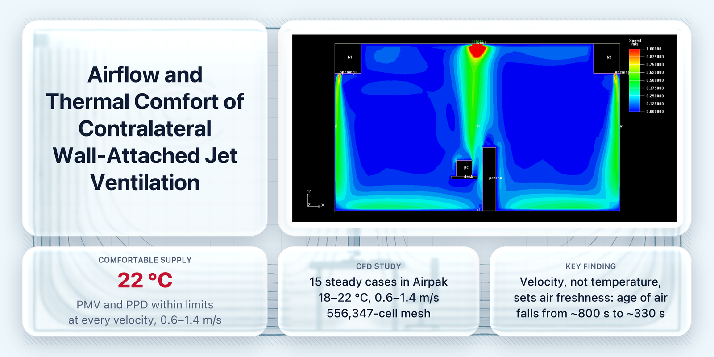

A CFD study of a ventilation layout that supplies air from slots on two opposite walls of a classroom, so that the jets cling to the walls, turn at the floor, and spread as cool "air lakes" from both sides.

*CFD project, Chongqing University, 2024. Advisor: Prof. Yong Cheng.* Full write-up: [`report/CFD_Report_English.pdf`](report/CFD_Report_English.pdf). Full paper (in Simplified Chinese): [`report/CFD_Paper_Chinese.pdf`](report/CFD_Paper_Chinese.pdf)

## Key findings

- **Air lakes form on both sides of the room** and meet at its center, where the flow turns upward; this extends the reach of single-wall supply in larger rooms.
- **Supply velocity matters more than supply temperature.** At a fixed velocity, each 2 °C step in supply temperature shifts PMV at the occupant by only 0.27 to 0.34, and the age of air is almost the same for all three temperatures.
- **Warm supply air is enough.** A 22 °C supply keeps the occupant within the PMV and PPD comfort limits at every velocity from 0.6 to 1.4 m/s, 20 °C does so up to 1.2 m/s, and 18 °C fails at every velocity.
- **Mild stratification.** The vertical temperature difference between 0.1 m and 1.1 m is 1.25 to 1.45 °C in all 15 cases.
- **Fresher air at higher velocity.** The age of air at the occupant falls from about 800 s at 0.6 m/s to about 330 s at 1.4 m/s.

## Method

1. Rebuilt a published single-wall laboratory case (5.4 × 7.0 × 3.16 m room, 2 m/s supply) in Airpak 3.0 and checked the simulated centerline velocities against the measurements.
2. Added a second supply slot on the opposite wall, an occupant (72 W), a computer (300 W), and a desk, with one exterior wall held at 35.5 °C for a hot summer day.
3. Ran 15 steady cases on a 556,347-cell hexahedral mesh: supply temperatures of 18, 20, and 22 °C and velocities of 0.6 to 1.4 m/s.
4. Evaluated PMV, PPD, age of air, and stratification at the occupant's breathing zone, and fitted the velocity decay along the wall jet (R² = 0.987).

## Repository contents

| Path | Contents |
|---|---|
| `report/CFD_Report_English.pdf` | Project report |
| `report/CFD_Paper_Chinese.pdf` | Full paper, in Simplified Chinese |
| `figures/` | Airpak model and result fields from the study (velocity, temperature, PMV/PPD, age of air) |
| `data/case_results.csv` | Temperature, air speed, age of air, PMV, PPD, and vertical temperature difference at the occupant for all 15 cases |
| `data/wall_jet_velocity_profile.csv` | Centerline velocity along the wall jet for the 22 °C, 0.8 m/s case, used for the decay fit |

## Notes

- Simulation only: the two-wall layout was not measured, and the model was validated against another team's measurements of single-wall supply.
- The energy argument is qualitative: comfort is reached with a warmer supply than conventional cooling, but no energy saving was calculated.
- The temperature, PMV/PPD, and age-of-air figures were exported from Airpak at screen resolution and are shown enlarged.
